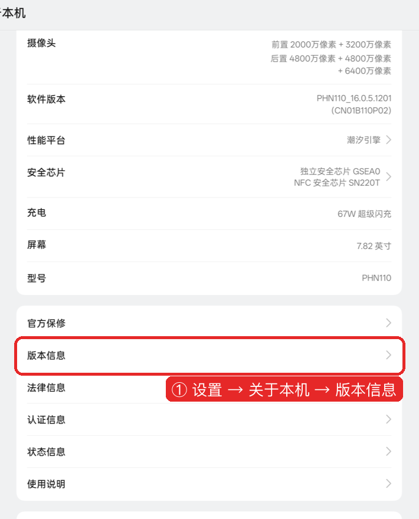
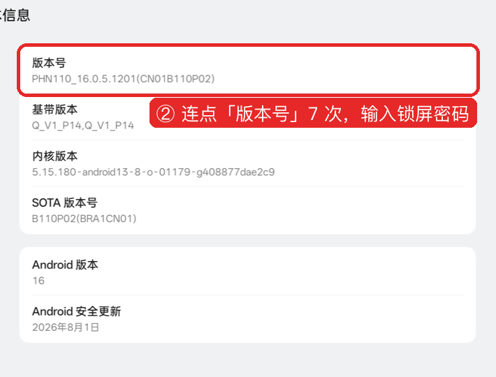
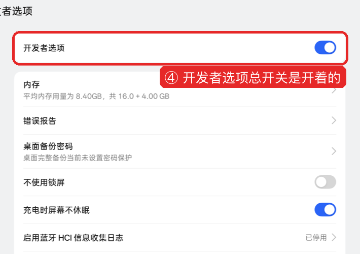
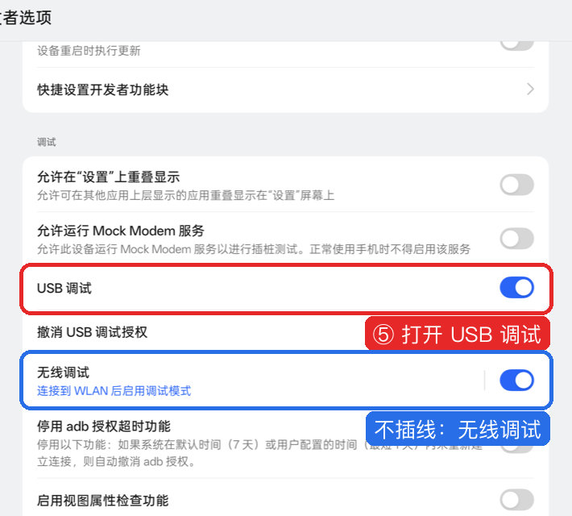

# 00 打开开发者模式和 USB 调试

用电脑处理手机（用法一）之前，手机上要打开两样东西：

| 要打开的 | 作用 |
|---|---|
| 开发者模式 | 让设置里出现「开发者选项」这一页 |
| USB 调试 | 允许电脑读手机屏幕、点按钮、改设置 |

只用手机照清单手动关（用法二、用法三），不需要这一页。

下面的截图来自 OPPO（ColorOS 16），其他品牌的入口名见每一步下面的表格。

---

## 第 1 步：找到「版本号」

| 品牌 | 路径 |
|---|---|
| OPPO / 一加 / realme | 设置 → 关于本机 → 版本信息 |
| 小米 / Redmi | 设置 → 我的设备 → 全部参数与信息 |
| vivo / iQOO | 设置 → 系统管理与升级 → 版本信息 |
| 荣耀 | 设置 → 关于手机 |
| 华为 | 设置 → 关于手机 |

## 第 2 步：连点 7 次

| 品牌 | 连点哪一项 |
|---|---|
| OPPO / 一加 / realme | 版本号 |
| 小米 / Redmi | OS 版本 |
| vivo / iQOO | 软件版本号 |
| 荣耀 / 华为 | 版本号 |

1. 连续点 7 次，屏幕下方会出现倒数提示：「再点 3 次」「再点 2 次」……
2. 弹出锁屏密码框，输入你的锁屏密码。
3. 提示「您已处于开发者模式」，这一步完成。

## 第 3 步：打开开发者选项

最快的办法：打开设置，在顶部搜索框输入「开发者选项」，点搜索结果。

按路径找也可以：

| 品牌 | 路径 |
|---|---|
| OPPO / 一加 / realme | 设置 → 系统与更新 → 开发者选项 |
| 小米 / Redmi | 设置 → 更多设置 → 开发者选项 |
| vivo / iQOO | 设置 → 系统管理与升级 → 开发者选项 |
| 荣耀 / 华为 | 设置 → 系统和更新 → 开发者选项 |

## 第 4 步：确认总开关开着

页面最上方的「开发者选项」开关要是蓝色（开）的。关着的话点开。

## 第 5 步：打开 USB 调试

1. 往下翻到「调试」一栏。
2. 打开「USB 调试」，弹窗点「确定」。
3. 不想插线，打开下面的「无线调试」，配对方法见 [01-准备工作](01-准备工作.md#不想插线无线调试)。

**小米 / Redmi 多一步**：同一页打开「USB 调试（安全设置）」。这一项要插 SIM 卡、登录小米账号。不开它，电脑能读屏幕，点不动按钮。

## 第 6 步：插线，点允许

1. 用数据线连电脑。只能充电的线不行，换一根能传文件的线。
2. 手机下拉通知栏，点 USB 那条通知，选「传输文件」。
3. 手机弹出「允许 USB 调试吗？」，勾「始终允许使用这台计算机进行调试」，点「允许」。

没看到弹窗：拔掉线重插一次；还没有，在开发者选项里点「撤销 USB 调试授权」，再插一次。

---

## 用完以后要关吗？

建议关。`run.py finish` 收尾时会提醒你。

| 原因 | 说明 |
|---|---|
| App 检测 | 部分银行、支付、游戏 App 检测到 USB 调试开着会提醒或拒绝运行 |
| 安全 | 关掉以后，别人拿你的手机插电脑也连不上 |

两种关法：

1. 手机上：设置 → 搜索「开发者选项」→ 关掉页面最上方的总开关。
2. 电脑上：`python3 tool/run.py -s <序列号> dev-off --yes`。执行后电脑和手机断开，这是正常的。不加 `--yes` 会拒绝执行。

`dev-off` 实测（OPPO Find N3 典藏版，ColorOS 16.0.5，2026-10-24）：

| 项 | 执行前 | 执行后 |
|---|---|---|
| 开发者模式 | 开 | 关（手机上核对） |
| USB 调试 | 开 | 关，电脑立刻断开 |
| 无线调试 | 开 | 关 |

关掉开发者模式**不会撤销**这次的改动：关掉的开关、挂起的包、关掉的通知都保持原样。以后要还原，重新打开开发者模式和 USB 调试。有的品牌关掉后要重新连点 7 次版本号，按第 1 步重来。

## 常见问题

| 现象 | 处理 |
|---|---|
| 点了 7 次没反应 | 点的位置不对，对照第 2 步的表格换一项点 |
| 提示「您已处于开发者模式」 | 之前打开过，跳到第 3 步 |
| 开发者选项里没有「USB 调试」 | 翻到「调试」一栏，在页面中下部 |
| 电脑上显示 `unauthorized` | 手机上的「允许」没点，见第 6 步 |
| 电脑上什么都没有 | 换数据线；USB 用途改「传输文件」 |
