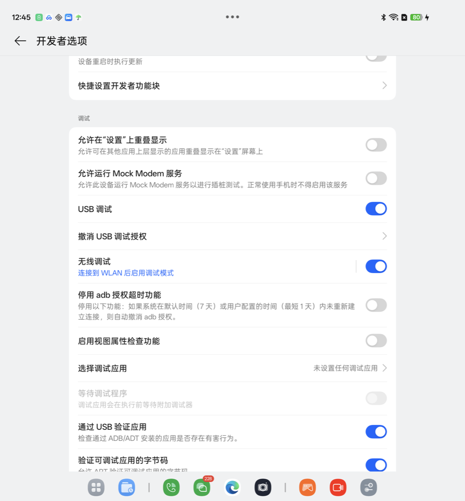

# 01 准备工作

用法一（AI 智能体）需要这一页。用法二、用法三只要手机，跳过本页。

## 要准备的东西

| 东西 | 说明 |
|---|---|
| 电脑 | macOS、Windows、Linux 都行 |
| 数据线 | 能传数据的线。只能充电的线插上后电脑认不到手机 |
| Python 3.9 以上 | macOS 自带或用 Homebrew 装；Windows 从 python.org 下载 |
| adb | Google 官方的 platform-tools |

## 第一步：装 adb

| 系统 | 做法 |
|---|---|
| macOS | `brew install android-platform-tools` |
| Windows | 下载 [platform-tools](https://developer.android.com/tools/releases/platform-tools)，解压到 `C:\platform-tools`，把这个目录加进 PATH |
| Linux | `sudo apt install adb` |

装好后在终端输入 `adb version`，能看到版本号就行。

## 第二步：装依赖

```bash
pip3 install -r requirements.txt
```

## 第三步：打开开发者选项

| 品牌 | 路径 |
|---|---|
| OPPO / 一加 / realme | 设置 → 关于本机 → 版本信息 → 连点「版本号」7 次 |
| 小米 / Redmi | 设置 → 我的设备 → 全部参数与信息 → 连点「OS 版本」7 次 |
| vivo / iQOO | 设置 → 系统管理与升级 → 版本信息 → 连点「软件版本号」7 次 |
| 荣耀 | 设置 → 关于手机 → 连点「版本号」7 次 |
| 华为 | 设置 → 关于手机 → 连点「版本号」7 次 |

点完会提示输入锁屏密码，输入后出现「您已处于开发者模式」。

## 第四步：打开 USB 调试

开发者选项在：

| 品牌 | 路径 |
|---|---|
| OPPO / 一加 / realme | 设置 → 系统与更新 → 开发者选项 |
| 小米 / Redmi | 设置 → 更多设置 → 开发者选项 |
| vivo / iQOO | 设置 → 系统管理与升级 → 开发者选项 |
| 荣耀 / 华为 | 设置 → 系统和更新 → 开发者选项 |

在「调试」一栏打开「USB 调试」。

<p align="center"></p>

小米手机还要打开「USB 调试（安全设置）」，这一项要求插 SIM 卡并登录小米账号。不开这一项，脚本能读屏，点不动。

## 第五步：连电脑

1. 插上数据线，手机下拉通知栏，把 USB 用途改成「传输文件」。
2. 手机弹出「允许 USB 调试吗？」，勾「始终允许使用这台计算机进行调试」，点「允许」。
3. 电脑上运行：

```bash
python3 tool/run.py devices
```

看到这样一行就连上了：

```text
7f386895   OPPO Find N3 典藏版   PHN110   PHN110_16.0.5.1201(CN01)   菜谱：无（只能跑通用部分）
```

第一列是序列号，后面的命令都要用它。

## 不想插线：无线调试

1. 手机和电脑连同一个 Wi-Fi。
2. 开发者选项 → 打开「无线调试」→ 点进去 → 「使用配对码配对设备」。
3. 弹窗里有 6 位配对码和一个「IP 地址:端口」，电脑上运行：

```bash
adb pair 192.168.31.100:37xxx      # 弹窗里的地址和端口
# 输入 6 位配对码
adb connect 192.168.31.100:41xxx   # 无线调试页面上方显示的地址和端口
```

配对端口和连接端口是两个不同的数字。配对只做一次；以后每次打开无线调试，连接端口会变，用新端口 `adb connect`。

## 折叠屏

把手机合上，用外屏操作。展开后系统设置和 App 是左右分栏，底部还有任务栏，引擎会找错位置。
