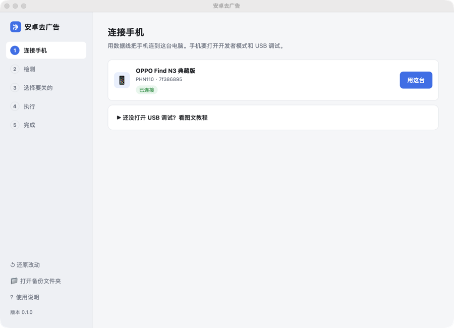
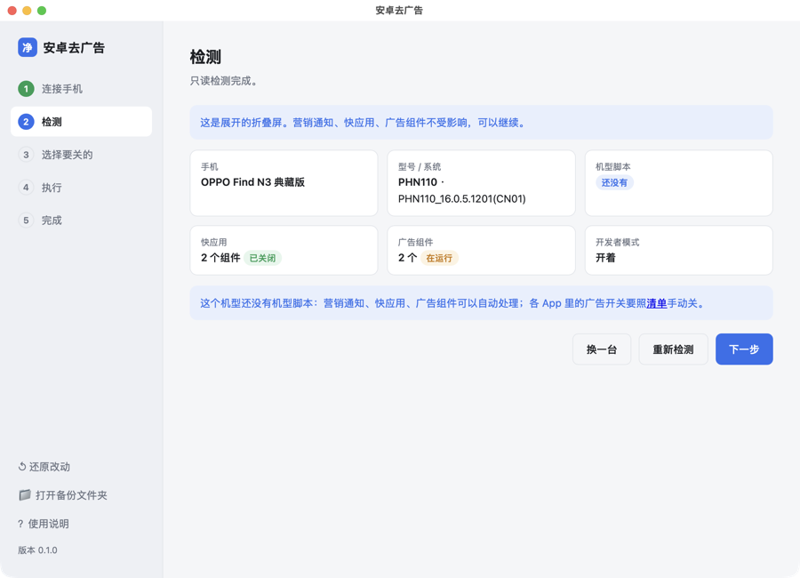
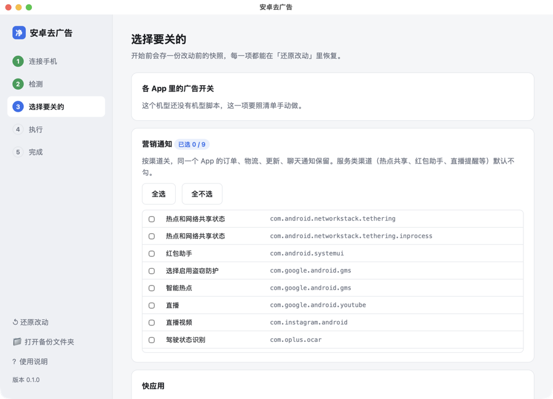
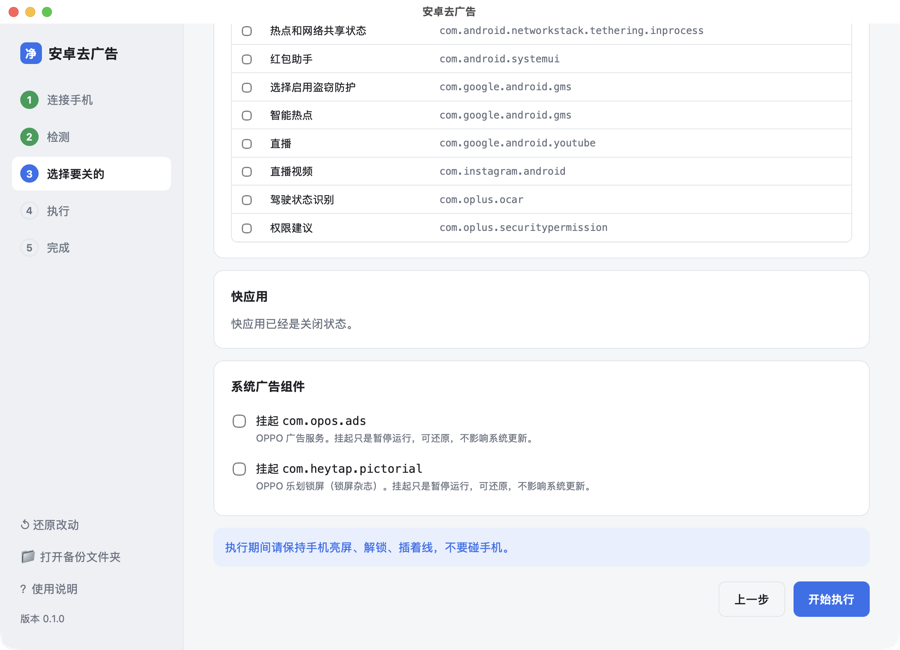

# 08 桌面客户端（Mac / Windows）

不想敲命令、不想用 AI 工具，用桌面客户端：插上手机，点几下按钮。
客户端调用的是同一套引擎（`tool/`），命令行能做的它都能做。

| 平台 | 安装包 | 状态 |
|---|---|---|
| macOS（Apple 芯片） | `AndroidAdCleaner-<版本>-mac-arm64.dmg` | 2026-10-24 在 OPPO Find N3 上实测，已签名、公证 |
| macOS（Intel 芯片） | `AndroidAdCleaner-<版本>-mac-intel.dmg` | 已签名、公证；在 Apple 芯片 Mac 的 Rosetta 下测过，Intel 真机待测 |
| Windows 10 / 11（64 位） | `AndroidAdCleaner-<版本>-windows-setup.exe`（安装版）<br>`AndroidAdCleaner-<版本>-windows-portable.zip`（免安装） | GitHub Actions 云端打包，冒烟测试通过（命令行模式、中文输出、adb 调用）；真机待测 |

## 下载和安装

在 [Releases 页面](https://github.com/rddmwmddr/android-ad-cleaner/releases/latest) 下载对应的安装包。

不知道自己的 Mac 是哪种芯片：点屏幕左上角的苹果图标 → 关于本机，「芯片」一栏写 Apple M 开头的是 Apple 芯片，写 Intel 的是 Intel 芯片。

**Mac**

1. 双击 dmg，把「安卓去广告」拖到旁边的「应用程序」文件夹。
2. 打开「安卓去广告」。安装包已经过苹果公证，双击就能打开。

**Windows**

1. 双击 `…-windows-setup.exe` 安装。不想安装，下载 `…-windows-portable.zip`，解压后双击 `AndroidAdCleaner.exe`。
2. 安装程序没有代码签名，Windows 会弹蓝色的「Windows 已保护你的电脑」：点「更多信息」→「仍要运行」。
3. 打开后提示缺少 WebView2：点「确定」去微软官网，下载安装「Evergreen Bootstrapper」，再打开本程序。Windows 11 自带，部分 Windows 10 要装。
4. 插上手机后客户端认不到：这台电脑缺手机的 USB 驱动，见下面「Windows 驱动」。

不需要装 Python，也不需要任何 AI 工具。电脑上没有 adb 的话，第一次打开时客户端会提示从 Google 官网下载（约 10 MB，只下一次）。

## 五步

**1. 连接手机**：插上数据线，客户端会认出手机。还没打开 USB 调试，页面里有图文教程。电脑上没有 adb，客户端会提示从 Google 官网下载。

<p align="center"></p>

**2. 检测**：读出型号、系统版本、有没有机型脚本、快应用和广告组件的状态。只读，不改东西。手机锁屏、折叠屏展开时会提示。

<p align="center"></p>

**3. 选择要关的**：

| 项目 | 默认 |
|---|---|
| 各 App 里的广告开关（有机型脚本时） | 勾选，可以按 App 取消 |
| 营销通知 | 营销类勾选，服务类（热点共享、红包助手、直播提醒等）不勾 |
| 快应用 | 不勾，你决定 |
| 系统广告组件 | 不勾，你决定 |

<p align="center"></p>
<p align="center"></p>

**4. 执行**：进度条加实时日志。执行期间不要碰手机。

**5. 完成**：列出每一步的结果。最后一张卡片是「关闭开发者模式」：点「帮我关闭」，客户端从电脑上关掉；或者自己在手机上关。关掉不会撤销这次的改动。

## 反馈

左下角「💬 反馈问题」，或者完成页里的「反馈这个问题」（有步骤失败时出现）。

1. 选类型：遇到问题 / 功能建议 / 适配新机型。
2. 写一句发生了什么。
3. 默认附带诊断信息：客户端版本、电脑系统、手机型号和系统版本、执行结果、最近 60 行日志。手机序列号已替换成 `<序列号>`，不含应用列表和通知内容。展开「查看 / 修改诊断信息」可以删改。
4. 点「提交到 GitHub」，浏览器打开新建 Issue 页面，内容已经填好。登录 GitHub 后点「Submit new issue」。

日志太长时，诊断信息会复制到剪贴板，在打开的页面里粘贴即可。

## 还原

左下角「还原改动」：恢复快应用、恢复挂起的广告组件、重新打开关掉的营销通知。还原要连着手机，开发者模式关掉了的话，按 [00-打开开发者模式](00-打开开发者模式.md) 重新打开。

## 数据放在哪

| 内容 | 位置 |
|---|---|
| 改动前的快照、营销通知清单、挂起记录 | `~/Library/Application Support/AndroidAdCleaner/backups/` |
| 客户端下载的 adb | `~/Library/Application Support/AndroidAdCleaner/platform-tools/` |

左下角「打开备份文件夹」可以直接打开。

## 从源码运行和打包

```bash
uv venv --python cpython-3.12-macos-aarch64 gui/.venv
uv pip install --python gui/.venv/bin/python pywebview pyinstaller uiautomator2 pillow
gui/.venv/bin/python gui/app.py          # 运行
gui/build_mac.sh                         # 打包到 gui/dist/
```

带签名和公证的打包（先在钥匙串里准备好 Developer ID Application 证书，并用 `xcrun notarytool store-credentials` 存好公证凭据）：

```bash
SIGN_ID="Developer ID Application: 名字 (TEAMID)" NOTARY_PROFILE=公证配置名 gui/build_mac.sh
```

## Windows 驱动

Mac 不需要驱动。Windows 认不到手机时，按品牌装驱动：

| 品牌 | 驱动 |
|---|---|
| 小米 / Redmi | 小米手机助手或 [Google USB Driver](https://developer.android.com/studio/run/win-usb) |
| OPPO / 一加 / realme | OPPO 手机助手，或 Google USB Driver |
| vivo / iQOO | vivo 手机助手 |
| 荣耀 / 华为 | 华为手机助手 / 荣耀手机助手（装完关掉它，避免占用连接） |
| 其他 | Google USB Driver |

装完重新插线，手机上点「允许 USB 调试」。

## 已知问题

| 现象 | 说明 |
|---|---|
| 窗口在后台时，第一下点击只把窗口切到前台 | macOS 网页窗口的默认行为，再点一次 |
| Windows 弹「Windows 已保护你的电脑」 | 安装程序没有代码签名，点「更多信息」→「仍要运行」 |
| Windows 版的数据位置 | `%APPDATA%\AndroidAdCleaner\`（快照、adb） |
| 折叠屏展开时不能跑机型脚本 | 合上用外屏；营销通知、快应用、广告组件不受影响 |
